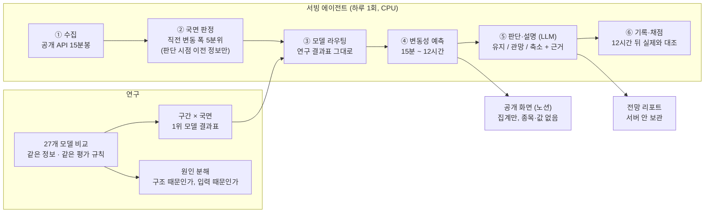

# 암호화폐 실현변동성 예측: 연구와 서빙

> **실시간 화면:** [국면 라우팅 변동성 예측 에이전트](https://gravel-turnover-821.notion.site/4196676605a9813cbd33c6a507183274) (하루 1회 갱신)
>
> 지금 시장이 얼마나 요동치는지(국면)를 먼저 판정하고, 연구에서 그 국면과 예측 구간에 가장 좋았던 모델로 예측을 보내는 서빙 에이전트의 구조와 최근 실행 결과입니다. 계산은 연구실 서버에서 하고, 화면에는 구간별 국면 종목 수와 모델별 사용 칸 수 같은 집계만 올립니다. 종목별 예측값은 싣지 않습니다.

이 저장소는 업비트 원화 시장 암호화폐의 15분봉 자료로 **다음 15분에서 12시간 동안 가격이 얼마나 크게 움직일지**(실현변동성)를 예측하는 연구와, 그 결과를 바탕으로 만든 예측 서빙 코드를 담고 있습니다. 연구의 중간 결과는 한국데이터정보과학회 2026 추계학술논문발표회에서 포스터 발표 우수상을 받았습니다.

## 전체 구조

연구가 만든 결과표가 그대로 서빙의 라우팅 표가 되고, LLM은 숫자 계산·모델 선택·주문 없이 통계 모형의 예측을 읽고 설명과 위험 노출 판단만 씁니다.

## 어떻게 믿을 수 있게 만들었나

사람이 AI의 보고를 "믿고 채택"하는 대신, 단계마다 자동 장치가 막는 구조로 만들었습니다.

| 시점 | 장치 | 하는 일 |
| :--- | :--- | :--- |
| 결과 전 | **사전 등록** | 가설·판정 기준·검정 방법을 결과를 보기 전에 문서로 고정하고 커밋합니다. 기각된 가설도 그대로 보고합니다. |
| 실행 전 | **자동 게이트** | 저장 결과 재현 일치, 미래 정보 누설 0건, 소량 전체 경로 통과를 확인하기 전에는 본 실행을 시작하지 않습니다. |
| 실행 후 | **독립 검산** | 쓰기 권한이 없는 별도 검증 환경이 원자료에서 다시 계산해 보고 수치와 대조한 뒤에만 승인합니다. |
| 공개 직전 | **차단 검사** | 비밀값·원시 시세 모양 수치가 요청이나 공개물에 섞이면 호출·게시 자체가 막힙니다. LLM이 쓴 숫자는 입력과 전수 대조하고, 틀리면 저장하지 않습니다. |
| 사고 후 | **규칙 승격** | 한 번 나온 실수는 수정으로 끝내지 않고 커밋 훅·자동 검사로 올려 같은 실수가 기계적으로 막히게 합니다. |

## 전향 예측 기록 (서빙 트랙)

서빙 쪽에서는 판정 규칙을 기록 시작 전에 문서로 고정해 두고, 15분마다 예측을 기록해 나중에 실제 변동과 대조합니다. 결과를 본 뒤 규칙을 바꿀 수 없게 만든 운영 자기 검증이며, 논문의 확증 판정과는 별개입니다.

## 무엇을 했나

- 가격이 오를지 내릴지(방향)는 자료에서 거의 예측되지 않았지만, 얼마나 크게 움직일지(변동 폭)는 상당 부분 예측되었습니다. 그래서 변동 폭 예측을 연구 대상으로 정했습니다.
- GARCH 같은 계량 모형, 그래디언트 부스팅, 순환 신경망(GRU·LSTM), 어텐션·합성곱 기반 딥러닝, 사전학습 시계열 파운데이션 모델까지 27개 모델을 같은 정보와 같은 평가 규칙으로 비교했습니다.
- 모델이 창 안의 시점을 차례로 처리하는가(순차 구조), 한꺼번에 처리하는가(병렬 구조)에 따라 결과가 어떻게 달라지는지, 그리고 그 차이가 구조 때문인지 입력 때문인지를 나눠서 확인했습니다.

## 폴더 안내

| 폴더 | 내용 |
| :--- | :--- |
| [`research/`](research/README.md) | 연구 개요, 연구 중에 확인한 발견 7가지, 그림 |
| [`serving/`](serving/README.md) | 서빙 참고 구현과 국면 라우팅 에이전트(국면 판정 → 칸별 1위 모델 라우팅 → 예측 → 설명 → 공개 집계), 노션 게시, LangGraph 전망 리포트 에이전트 |

## 자료에 관한 안내

업비트 원시 시세와 그 시세에서 시각마다 계산한 값(실현변동성, 예측값 등)은 이 저장소에 넣지 않습니다. 문서에는 종목과 구간을 묶은 요약 수치와 그림만 싣습니다. 상세 결과 표는 추후 공개합니다.
