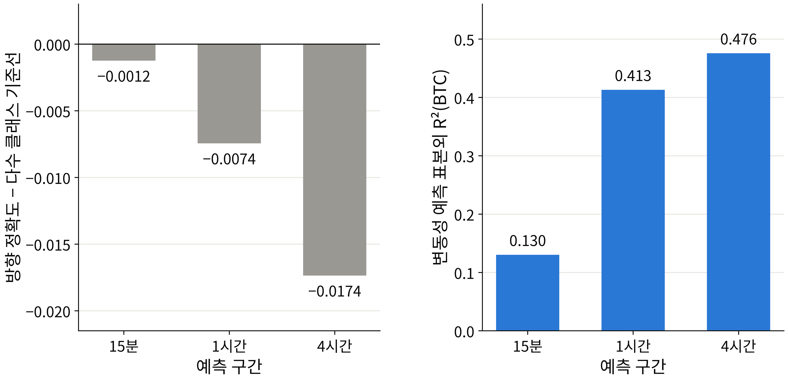

# 발견 1. 방향은 예측되지 않고, 변동 폭은 예측된다

## 무엇이 궁금했나

처음 목표는 가격이 오를지 내릴지를 맞히는 것이었습니다. 그런데 금융 수익률은 방향을 맞히기 어렵고 크기는 상당 부분 예측된다는 것이 오래된 정형화된 사실입니다. 이 자료에서도 그런지, 그렇다면 무엇을 예측 대상으로 삼아야 하는지를 먼저 확인했습니다.

## 무엇을 확인했나

**자기상관 비교.** 자기상관은 오늘 값과 직전 값이 얼마나 같이 움직이는지를 −1에서 1 사이로 나타낸 값입니다. 0에 가까우면 직전 값이 다음 값에 대해 알려 주는 것이 거의 없다는 뜻입니다.

| 대상(21종목 평균) | 1차 자기상관 |
| :--- | ---: |
| 15분 수익률(방향과 크기를 함께 담음) | −0.13 |
| 15분 절대수익률(크기만 담음) | 0.35 |

수익률 자체는 직전 값과 약하게, 그것도 반대 방향으로만 이어졌지만, 절대수익률은 뚜렷하게 이어졌습니다. 크게 움직인 뒤에는 다시 크게 움직이는 경향(변동성 군집)이 있다는 뜻입니다.

**직접 맞혀 보기.** 로지스틱 회귀로 다음 구간의 방향을 맞혀 보고, 같은 자료로 선형 회귀로 변동성을 맞혀 봤습니다.

- **그림 읽는 법:** 왼쪽 패널은 방향 예측 정확도에서 "항상 더 자주 나온 쪽을 고르는 기준선(다수 클래스 기준선)"의 정확도를 뺀 값입니다(21종목 평균). 0보다 작으면 아무 정보 없이 찍는 것보다 못하다는 뜻입니다. 오른쪽 패널은 BTC 변동성 예측의 표본외 결정계수 R²입니다. 학습에 쓰지 않은 기간에서 실제 변동의 몇 %를 설명했는지를 나타냅니다.
- **관찰:** 방향 예측은 15분 −0.0012, 1시간 −0.0074, 4시간 −0.0174로 모든 구간에서 기준선보다 낮았습니다. 같은 자료의 변동성 예측은 BTC에서 15분 0.130, 1시간 0.413, 4시간 0.476을 설명했습니다.

## 그래서 무엇을 정했나

- 예측 대상을 가격의 방향에서 **다음 구간의 변동 폭**, 곧 실현변동성(RV)으로 바꿨습니다. RV는 다음 구간 안의 15분 수익률을 제곱해 더한 뒤 제곱근을 취한 값으로, 수익률과 같은 단위를 가집니다.
- 방향 예측은 변동성 예측이 안정된 뒤의 후속 과제로 미뤘습니다.
- 이 결정 뒤의 모든 설계(자료 처리, 모델 선정, 평가)는 변동성 예측을 기준으로 다시 짰습니다.
