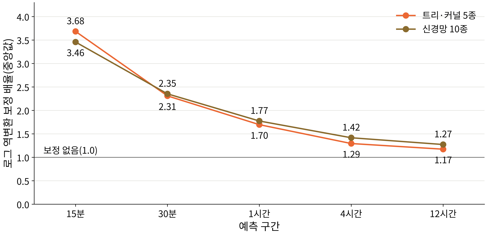

# 발견 4. 로그로 학습한 예측은 되돌릴 때 작아진다

## 무엇이 궁금했나

트리·커널·신경망 모델은 log RV를 학습합니다. 예측을 원래 단위로 쓰려면 지수 함수로 되돌려야 하는데, 로그 척도의 평균을 지수로 되돌리면 원래 척도의 평균보다 작아집니다. 이것을 역변환 편향이라고 합니다. 예를 들어 실제 값이 1과 100인 두 시점에서 로그 평균을 되돌리면 10이 되지만, 원래 평균은 50.5입니다. 이 편향이 이 자료에서 얼마나 크고, 모델 비교를 얼마나 흔드는지 확인했습니다.

## 무엇을 확인했나

**보정 배율.** 보정 배율 c₊는 "되돌린 예측에 몇 배를 곱해야 실제 분산 수준과 맞는가"를 나타냅니다. 학습에 쓰지 않은 내부 검증 구간에서 `c₊ = mean(RV² / p̂_raw²)`로 추정했습니다(Duan, 1983의 smearing 방법). 1이면 보정이 필요 없다는 뜻이고, 1보다 크면 그만큼 과소 예측하고 있었다는 뜻입니다.

- **그림 읽는 법:** 가로축은 예측 구간, 세로축은 보정 배율입니다. 두 선은 모델 묶음별 중앙값이고(트리·커널 5종과 신경망 10종, 시드 20개), 검은 가로선은 보정이 필요 없는 1.0입니다.
- **관찰:**

| 모델 묶음 | 15분 | 12시간 |
| :--- | ---: | ---: |
| 트리·커널 | 3.68 | 1.17 |
| 신경망 | 3.46 | 1.27 |

15분에서는 되돌린 예측이 실제 분산 수준의 약 3분의 1에도 못 미쳤고, 구간이 길어질수록 배율은 1에 가까워졌습니다. 로그 척도에서 예측 오차의 흩어짐이 클수록 로그 평균과 원래 평균의 차이가 커지는데, 짧은 구간일수록 잡음이 커서 이 흩어짐이 큽니다.

**비교에 미치는 영향.** 이 편향을 보정하지 않으면, 로그로 학습한 모델과 분산을 직접 예측하는 GARCH 계열 사이의 순위가 예측력이 아니라 역변환 방식에 따라 갈립니다. 특히 짧은 구간에서 로그 학습 모델이 부당하게 불리해집니다.

## 그래서 무엇을 정했나

- 로그로 학습하는 모든 모델에 **같은 규칙으로 추정한 보정 배율**을 곱했습니다. 배율은 종목·구간·모델마다 내부 검증 구간에서 추정하고, 평가 구간 자료는 쓰지 않습니다.
- 보정 배율을 추정한 모델과 예측을 내는 모델이 같도록, 학습 구간 전체로 다시 적합하지 않았습니다. 다시 적합하면 둘이 어긋나 15분 손실이 오히려 0.09 나빠졌습니다.
- 서빙 코드도 같은 순서(로그 예측 → 지수 변환 → 보정 배율 → 정지 확률 결합)를 따릅니다.
