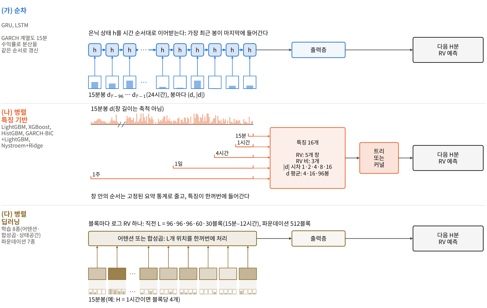
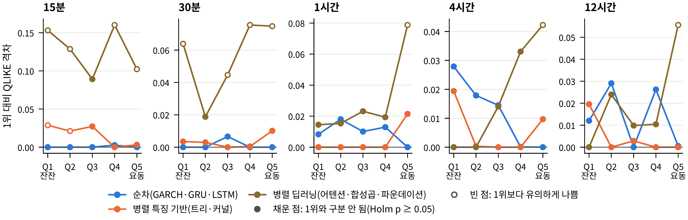

# 발견 6. 순환 신경망의 우위는 구조보다 입력에서 왔다

## 무엇이 궁금했나

연구의 중심 질문입니다. 창 안의 시점을 차례로 처리하며 상태를 이어받는 순차 구조(GRU, LSTM)가, 시점을 한꺼번에 처리하는 병렬 딥러닝(PatchTST, iTransformer 등)보다 변동성을 더 잘 예측하는가?

비교에는 함정이 하나 있었습니다. 두 계열은 보통 입력부터 다릅니다.

- **그림 읽는 법:** (가) 순차 구조(GRU, LSTM)는 직전 96개 15분봉(24시간)의 수익률을 시간 순서대로 읽습니다. 수익률 d는 요일·시간대별 평균 변동 수준으로 나눠 주기를 없앤 값입니다. (나) 특징 기반 병렬 모델은 여러 시간 척도의 RV 요약값을 한꺼번에 받습니다. (다) 병렬 딥러닝은 H분 구간마다 하나의 log RV로 요약한 블록들을 한꺼번에 처리합니다. 막대 높이는 설명용이며 실제 자료가 아닙니다.
- 순환 신경망은 창 안의 15분 경로를 그대로 보고, 병렬 딥러닝은 구간마다 요약된 블록만 봅니다. 따라서 둘의 성능 차이가 처리 방식에서 오는지, 입력 표현에서 오는지를 나누지 않으면 구조에 관한 결론을 내릴 수 없습니다.

## 무엇을 확인했나

**1단계: 원래 입력 그대로 비교.**

- **그림 읽는 법:** 패널은 예측 구간입니다. 가로축은 국면(Q1 잔잔 – Q5 요동), 세로축은 처리 방식 묶음별 최선 모델이 그 칸 1위보다 손실(QLIKE)이 얼마나 큰지입니다. 파랑은 순차, 주황은 특징 기반 병렬, 갈색은 병렬 딥러닝입니다. 채운 점은 1위와 통계적으로 구분되지 않고, 빈 점은 유의하게 나쁩니다.
- **관찰:** 가장 요동하는 국면(Q5)에서 순환 신경망은 병렬 딥러닝보다 다섯 구간 모두 유의하게 나았습니다(손실 차이 −0.111 – −0.175). 30칸(5구간 × 전체 + 5국면) 전체로는 16칸에서 나았고 나쁜 칸은 없었습니다.
- **재현:** 판정 규칙을 미리 등록하고, 자료를 한 번도 보지 않은 2020–2023년 과거 기간에 같은 절차를 한 번 적용했습니다. 학습형 병렬 딥러닝 8개가 Q5에서 칸 1위보다 나쁘다는 판정이 40쌍 중 37쌍에서 재현되었습니다.

**2단계: 입력을 맞춘 비교.** GRU와 LSTM에 병렬 딥러닝과 똑같은 블록 입력을 주고, 같은 학습 절차로 다시 학습했습니다(시드 5개).

| 비교 | Q5 결과 |
| :--- | :--- |
| 같은 블록 입력: 순환 신경망 대 병렬 딥러닝 | 다섯 구간 모두 구분되지 않음 |
| 같은 순환 신경망: 15분봉 경로 입력 대 블록 입력 | 경로 입력이 30분·1시간·4시간에서 손실 0.042–0.090 낮음 |

입력을 맞추자 순환 신경망의 우위가 사라졌고, 같은 순환 신경망 안에서 입력만 바꾸자 차이가 다시 나타났습니다.

**왜 경로가 도움이 되는가.** 요동 국면에서는 직전 창의 변동이 뒤쪽 절반에 얼마나 몰려 있는지가 다음 변동 폭과 더 강하게 연결되었습니다. 블록 요약 입력은 창 안의 이런 순서 정보를 잃습니다.

## 그래서 무엇을 정했나

- 결론을 "순차 구조가 우월하다"가 아니라 **"요동 국면의 순환 신경망 우위는 구조보다 15분봉 경로 입력과 더 관련이 있다"**로 적었습니다.
- 실무 권고는 "구조를 바꾸기 전에 입력 표현을 먼저 바꿔 보라"입니다.
- 남은 단서도 함께 적었습니다.
  - "구분되지 않음"은 "같음"과 다릅니다. ±0.02 범위의 동등성 검정은 어느 구간에서도 동등성을 보이지 못했습니다.
  - 15분에서는 같은 입력에서도 차이가 반대 방향으로 나타나, 15분의 우위는 입력으로 설명되지 않습니다.
  - 두 입력은 형태뿐 아니라 보는 과거의 길이도 다릅니다. 형태와 길이를 나누는 재학습을 진행하고 있습니다.
