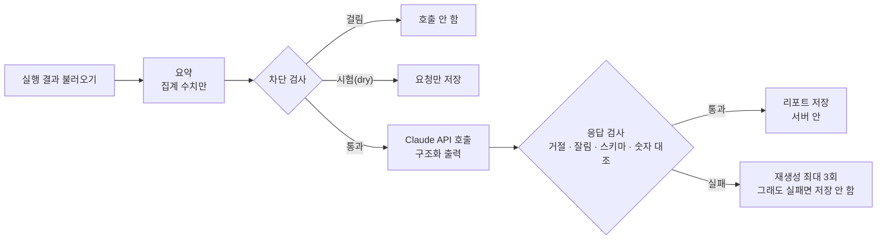

# 서빙 참고 구현과 국면 라우팅 에이전트

연구 결과를 바탕으로, 예측 구간마다 정한 모델로 **다음 H분 동안의 실현변동성(RV)** 을 예측하는 작은 파이썬 패키지입니다. 그 위에 국면마다 모델을 바꾸는 에이전트, 공개 화면(노션) 게시, 전망 리포트 에이전트를 얹었습니다([아래](#국면-라우팅-에이전트)). 운영용 서비스가 아니라, 연구에서 정한 처리 순서를 그대로 옮긴 참고 구현입니다. 연구 코드를 옮겨 오지 않고 새로 작성했습니다.

## 예측 구간별 모델

| 예측 구간 | 모델 | 고른 이유 |
| :--- | :--- | :--- |
| 15분, 30분 | GARCH-BIC | 연구의 전체 기간 1위 |
| 1시간, 4시간 | GARCH-BIC+LightGBM | 연구의 전체 기간 1위 |
| 12시간 | Nystroem+Ridge | 연구의 전체 기간 1위 |
| (선택) 가장 요동하는 국면 | GRU | 연구에서 1시간·4시간 Q5 1위 |

국면에 따라 모델을 바꾸는 경로(GRU)는 **기본으로 꺼 두었습니다.** 연구에서 전체 기간 1위가 가장 요동하는 국면에서도 그 국면 1위와 통계적으로 구분되지 않았기 때문입니다. 필요하면 `regime_route`로 켤 수 있습니다.

## 처리 순서

1. **입력:** 15분 격자에 맞춘 로그 수익률. 체결이 없던 봉은 수익률 0으로 채웁니다.
2. **주기 제거:** 요일×시간대(168칸)별 평균 변동 수준으로 수익률을 나눕니다.
3. **GARCH-BIC:** 10개 사양(GARCH(1,1)·(2,1)·(1,2), GJR-GARCH, FIGARCH × t·skew-t 오차) 가운데 BIC가 가장 작은 사양으로 15분 분산을 H/15봉 앞까지 재귀로 이어 더합니다.
4. **로그 타깃 모델(LightGBM, Nystroem+Ridge, GRU):**
   - 정지가 아닐 때의 log RV를 예측하고 지수로 되돌립니다.
   - 학습 범위를 벗어난 예측은 학습 평균으로 바꿉니다.
   - 내부 검증 구간에서 추정한 보정 배율 c₊를 곱합니다(로그 역변환 편향 보정).
   - 다음 구간이 가격 정지일 확률 π를 LightGBM 분류기로 추정해 (1 − π)를 곱합니다.
   - 요일×시간대 주기를 되돌립니다.
5. **국면:** 직전 H분 RV가 학습 구간 분포의 어느 5분위에 드는지(1 잔잔 – 5 요동)를 함께 돌려줍니다.
6. **예측 국면(판단 기준):** 고정 GARCH-BIC 예측이, 같은 모형이 학습 구간의 같은 시각에 낸 예측값 분포의 어느 5분위에 드는지를 함께 돌려줍니다(`forecast_regime`). 같은 종류(예측끼리, 같은 시각끼리)로 비교하므로 평소라면 각 5분위가 20% 안팎입니다.

각 단계의 근거는 [연구 발견 문서](../research/README.md#연구-중에-확인한-발견)에 있습니다.

## 국면 라우팅 에이전트

[실시간 화면](https://gravel-turnover-821.notion.site/4196676605a9813cbd33c6a507183274)에 올라가는 에이전트의 참고 구현입니다(`volserve/agent.py`). 여러 종목을 한 번에 받아 여섯 단계를 차례로 거칩니다.

| 단계 | 하는 일 |
| :--- | :--- |
| 1. 입력 확인 | 종목별 15분 수익률에 결측이 없는지, 적합한 종목인지 확인합니다. |
| 2. 국면 판정 | 직전 H분 RV가 그 종목 학습 구간 분포의 어느 5분위에 드는지(Q1 잔잔 – Q5 요동) 정합니다. |
| 3. 모델 라우터 | 구간 × 국면 칸마다 연구 1위 모델을 고릅니다(`volserve/routing.py`). |
| 4. 예측 | 고른 모델로 다음 H분 RV를 예측합니다. |
| 5. 설명 생성 | 왜 이 모델인지, 직전 대비 몇 배인지 문장으로 씁니다. |
| 6. 공개 집계 | 구간별 국면 종목 수와 모델별 사용 칸 수만 따로 만듭니다. 종목 이름과 예측값은 넣지 않습니다. |

### 라우팅 표

괄호 안 수는 그 칸 1위와 통계적으로 구분되지 않은 다른 모델 수입니다(Holm 보정). 이 수가 크면 "1위"는 여러 동등한 후보 중 하나라는 뜻입니다.

| 구간 | Q1 | Q2 | Q3 | Q4 | Q5 |
| :--- | :--- | :--- | :--- | :--- | :--- |
| 15분 | GARCH-BIC (1) | GARCH-BIC (1) | GARCH-BIC (4) | GARCH-BIC (2) | LSTM (8) |
| 30분 | GARCH-BIC (5) | GARCH-BIC (8) | GARCH-BIC+LightGBM (8) | GARCH-BIC (9) | LSTM (6) |
| 1시간 | GARCH-BIC+LightGBM (16) | TimesFM (22) | TimesFM (22) | GARCH-BIC+LightGBM (6) | GRU (6) |
| 4시간 | TimesFM (15) | TimeXer (24) | Nystroem+Ridge (19) | Nystroem+Ridge (9) | GRU (4) |
| 12시간 | Nystroem+Ridge | Nystroem+Ridge | Nystroem+Ridge | Nystroem+Ridge | Nystroem+Ridge |

이 패키지가 구현한 모델은 GARCH-BIC, GARCH-BIC+LightGBM, Nystroem+Ridge, GRU 넷입니다. 1위가 LSTM이면 GRU로, TimesFM·PatchTST·TimeXer면 GARCH-BIC+LightGBM으로 대신하고, 공개 집계에 "(대신 구현)"으로 표시합니다.

```python
from volserve import RegimeRoutingAgent, public_summary

agent = RegimeRoutingAgent().fit({tk: r.loc[:"2025-11-10"] for tk, r in returns_by_ticker.items()})
run = agent.run(returns_by_ticker)
for cell in run.cells:
    print(cell.explanation)
summary = public_summary(run)   # 공개해도 되는 집계만
```

### 공개 화면(노션)

`volserve/notion_page.py`가 공개 집계를 노션 블록(단계 시간, 라우팅 표, 국면 분포, 모델 사용)으로 바꿔 페이지 본문을 새로 씁니다. 새 블록을 먼저 붙이고 지난 블록을 지워서 갱신 중에 빈 페이지가 보이지 않게 합니다. 블록을 만든 뒤 종목 이름과 값 모양 수가 섞였는지 다시 확인합니다. 노션에서 그 페이지를 웹에 게시하면 notion.site 주소로 공개됩니다.

### 전망 리포트 에이전트(LangGraph + Claude API)

`volserve/outlook_report.py`는 실행 결과를 요약해 Claude API에 보내고, 변동성 전망 리포트와 위험 노출 판단(유지·관망·축소)을 받는 LangGraph 상태 그래프입니다.



- **요약:** 구간별 지금 국면·예측 국면 종목 수, 쓴 모델, 예측/직전 변동성 배율의 사분위(참고), 배율 상위·하위 세 종목만 보냅니다. 원시 시세와 촘촘한 시계열은 보내지 않습니다.
- **차단 검사:** 보내기 직전 요청 본문에서 환경 변수의 키·토큰 값, 키 모양 문자열, 원시 시세 항목 이름(open·close·volume 등), 가격 모양 큰 수, 연속 숫자 배열, 지나친 크기를 찾습니다. 하나라도 있으면 호출하지 않습니다.
- **호출·응답 검사:** 구조화 출력(JSON 스키마)으로 설명 문장(시장 상태, 전망 결론, 전망 이유, 판단 설명, 유의점)을 받고, 거절·잘림·스키마 위반을 확인합니다. 리포트 본문 조립과 판단 계산은 코드가 합니다. 호출 모델, 응답 모델, 토큰 수, 소요 시간을 상태에 남깁니다.
- 가격 방향은 말하지 않으며, 투자 권유가 아닌 참고용입니다. `write_report(run, dry=True)`는 보내지 않고 검사까지만 합니다.

#### 판단 품질 관리

- **판단은 코드 계산(평소 대비):** 위험 노출 판단(유지/관망/축소)은 LLM이 아니라 고정 규칙으로 코드가 계산합니다. 비교 기준은 바로 직전 구간이 아니라 평소(학습 구간)이고, 기준은 예측 국면입니다. 표는 세 개입니다: 15분·30분·1시간을 합친 단기 표(세 구간 예측이 같은 조건부 분산에서 나와 사실상 한 신호라서입니다), 4시간, 12시간. 축소: 4시간 또는 12시간 표에서 예측 국면 Q5 비율이 0.5를 넘을 때. 관망: 축소가 아니면서 어느 표든 Q4+Q5 비율이 0.6을 넘을 때. 유지: 그 밖. 문턱은 실시간 결과를 보기 전에 학습 구간에서만 정했습니다(매일 같은 시각 판단 비율이 축소 10~15%, 관망 20~25%에 들도록). 예측/직전 배율은 직전이 잔잔하면 평균으로 되돌아가는 성질 때문에 기계적으로 1을 넘기 쉬워 참고로만 보여 줍니다. LLM은 이 판단의 설명 문장만 씁니다.
- **일치율 채점(이력):** 판단을 LLM에 맡겼던 이전 버전에서는 같은 입력을 반복 투입해 판단 일치율을 채점했고, 명시 규칙 기반으로 바꿔 일치율 1.0을 확인한 뒤 판단 자체를 코드로 옮겼습니다.
- **숫자 전수 대조:** LLM이 쓴 문장의 모든 숫자를 입력 요약과 자동 대조합니다(표의 숫자는 코드가 입력에서 그대로 옮깁니다). 입력에 없는 숫자가 나오면 다시 생성하고(최대 3회), 그래도 실패하면 저장하지 않습니다.
- **빈 값 처리:** 응답에 null·None·NaN 같은 빈 값 표기가 나오면 숫자 대조에서 걸려 다시 생성합니다. 값이 없는 칸은 지어내지 않습니다.

이 폴더의 참고 구현(`volserve/outlook_report.py`)이 위 판단 규칙 계산(`stance_detail`), 숫자 전수 대조(`number_issues`), 재생성(최대 3회)과 실패 시 저장 안 함을 모두 담고 있습니다. `tests/test_outlook_report.py`가 합성 자료와 가짜 응답으로 네트워크 없이 시험합니다. Claude 호출은 `write_report(run, dry=False, call=...)`의 `call` 자리에 바꿔 끼울 수 있고, 기본값은 API 키 경로(`call_claude`)입니다. 연구실 서버의 기본 호출 경로는 팀 구독 Claude Code입니다.

## 사용법(단일 종목)

```python
import pandas as pd
from volserve import VolatilityService

returns = ...  # pd.Series, DatetimeIndex 15분 간격, 로그 수익률(체결 없던 봉은 0)
svc = VolatilityService().fit(returns.loc[:"2025-11-10"])
fc = svc.predict(returns, horizon_minutes=60)
print(fc.model, fc.rv, fc.halt_prob, fc.regime)
```

## 시험

실제 시세 대신 GARCH(1,1)로 만든 합성 수익률에 가격 정지를 섞어 전체 흐름을 시험합니다. 에이전트 시험은 라우팅 표의 모든 칸, 공개 집계에 종목 이름·값이 없는지, 리포트 차단 검사가 비밀값·촘촘한 계열·가격·원시 시세 이름을 막는지, 그래프 시험 실행이 아무것도 보내지 않는지 확인합니다(네트워크 없음).

```bash
pip install -r requirements.txt
python -m pytest tests
```

## 한계

- 하이퍼파라미터는 연구의 탐색 결과가 아니라 고정된 기본값입니다.
- 모델은 한 번 학습한 뒤 다시 적합하지 않습니다. 새 자료로 주기적으로 다시 학습하는 절차는 포함하지 않았습니다.
- 데이터 수집 코드와 시세 자료는 포함하지 않습니다.
- 라우팅 표의 1위 중 LSTM·TimesFM·PatchTST·TimeXer는 이 패키지에 구현하지 않아 다른 모델로 대신합니다.
- 실시간 화면의 에이전트는 연구실 서버에서 같은 구조로 돌며, 그쪽 구현과 이 참고 구현은 세부(학습 설정·구현 모델)가 다를 수 있습니다.
